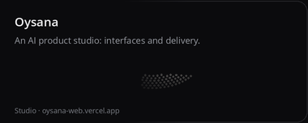
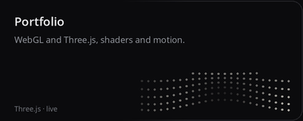
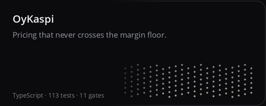

  <a href="https://yqecea-portfolio.web.app">portfolio</a> &nbsp;·&nbsp;
  <a href="https://oysana-web.vercel.app">oysana studio</a> &nbsp;·&nbsp;
  <a href="mailto:yqecea@gmail.com">email</a>

I build interfaces and then prove they work. Most of my code is written with coding agents, and most of my time goes into the part they cannot do: deciding what the screen should do, and writing the check that tells us whether it does.

## How I work

A screen is done when three things agree: the design intent, the test, and what a real person sees. I keep the acceptance rule explicit, because the agent will happily tell you it succeeded.

- **OyKaspi** — a pricing tool where an empty corridor returns an error instead of a price. 113 unit tests, 38 evals, 11 blocking gates.
- **OyVoice** — dictation with three honest outcomes instead of a guess; text is verified only after a readback from the field.
- **TasteCode** — 12 commits merged into someone else's main branch, plus the Linux packaging line.

## Stack

`TypeScript` `Flutter` `Dart` `Python` `Go` `Rust read/review` `HTML/CSS` `Playwright` `Electron` `WebGL` `Postgres` `Figma` `Pencil`

Astana, Kazakhstan · UTC+5 · open to a 4-hour daily internship
