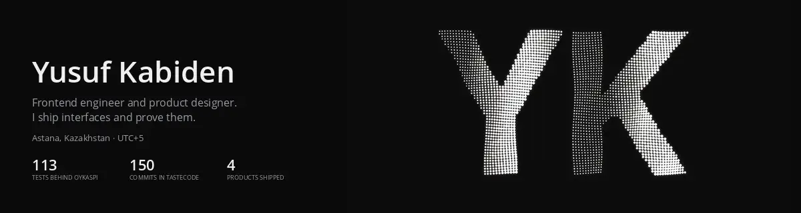
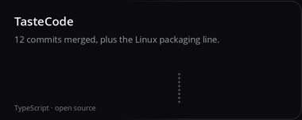

# Yusuf Kabiden

AI & Design Engineer in Astana. I run autonomous multi-agent setups and ship product UI.

## What I work on

- Multi-agent systems: outer and inner loop orchestration across Hermes, Claude Code, Devin, OpenCode, Antigravity, and Codex. Role routing, verification gates, proof-of-work ledgers.
- Product UI and design engineering: React, Next.js, TypeScript, Flutter, Playwright. A screen is done when the design intent, the test, and what a real person sees agree.
- LangChain Academy, in progress.

## Public work

- [`Leonxlnx/tastecode`](https://github.com/Leonxlnx/tastecode): 12 commits merged into upstream main, including PR #1211, #1171, and a UI error-visibility fix.
- [`gem-swarm`](https://github.com/yqecea/gem-swarm): multi-agent orchestration extension for Gemini CLI. 20 specialist agents, native parallel dispatch.
- [`vertex-design-system`](https://github.com/yqecea/vertex-design-system): industrial design system on Geist tokens. 69 components, zero-dependency CSS build.
- [`repo-10x`](https://github.com/yqecea/repo-10x): planning-first agent skill for deep repository transformation.
- [`skill-doctor`](https://github.com/yqecea/skill-doctor): zero-dependency linter for agent skill directories across .claude, .agents, .pi, .codex, .gemini, and .opencode layouts.

<a href="https://yqecea-portfolio.web.app">portfolio</a> &nbsp;·&nbsp; <a href="mailto:yqecea@gmail.com">email</a>

